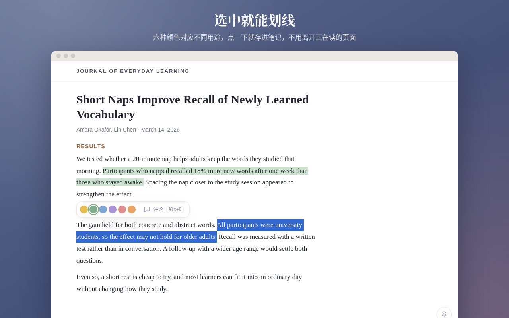
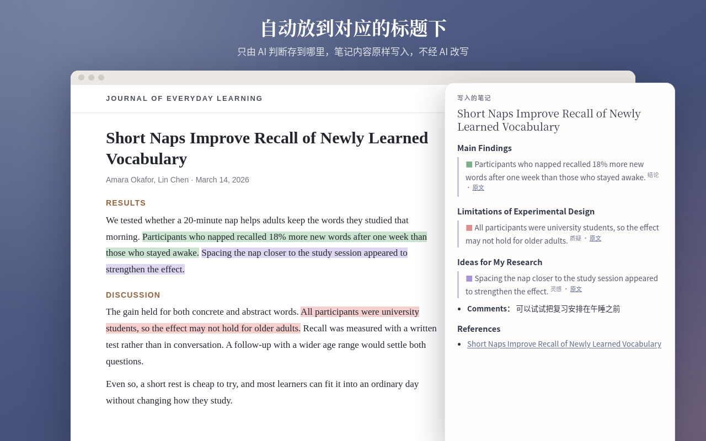
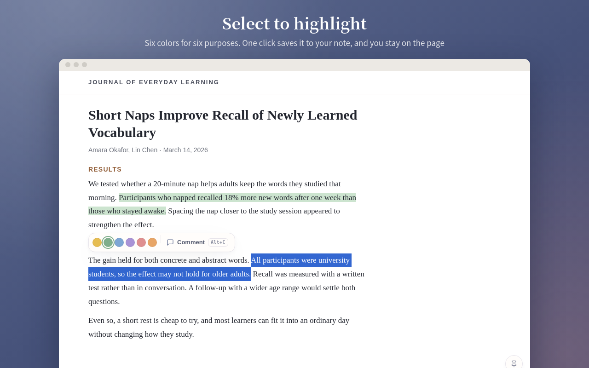
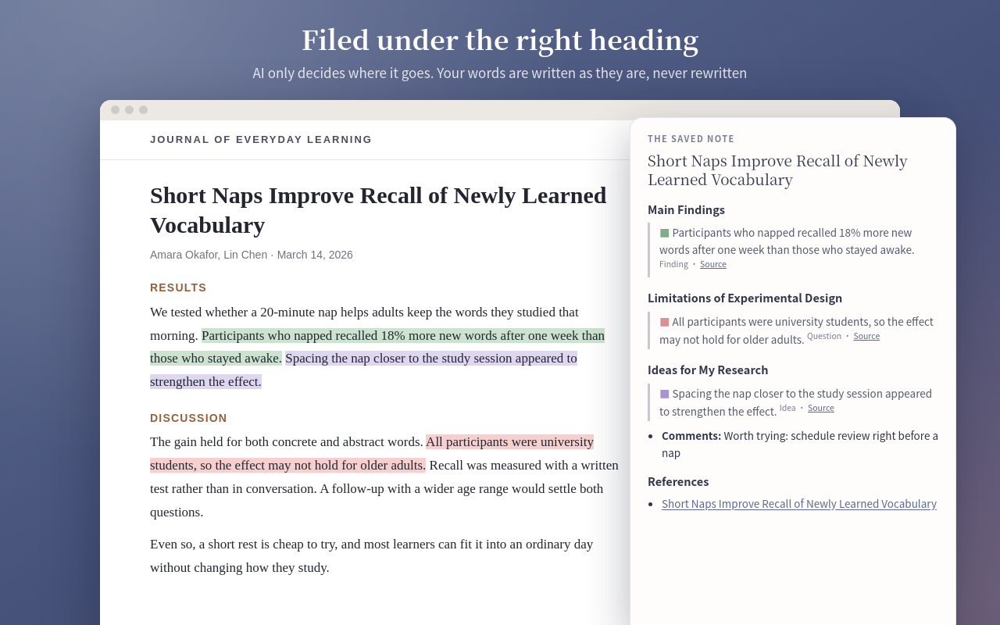

<p align="center">
  
</p>

<h1 align="center">Selectiophile</h1>

<p align="center">
  在网页上划线和评论，一键存到 Obsidian 笔记的对应标题下，并可把原文剪藏入库。<br>
  Highlight and comment on web pages, file each under the right heading of your Obsidian note, and keep the page as the original.
</p>

<p align="center">
  <a href="#中文">中文</a> · <a href="#english">English</a>
</p>

---

## 中文

Selectiophile（原名 Lectiophile）是给在网页上读论文、在 Obsidian 里记笔记的人用的 Chrome 扩展。选中一段话，写不写评论都行，它会存到对应笔记的对应标题下，你接着往下读就好。

AI 只判断存到哪里，从不改写你的笔记；没有 API Key 也能用，由你自己选标题。

<p align="center">
  <br><br>
  
</p>

### 功能

- **划线和评论**：选中后点颜色或按 `Alt+S` 保存，按 `Alt+C` 先写评论。六种颜色，用途自己命名。高亮重新打开网页后还在，点击可改颜色、评论、位置或删除。
- **自动归位**：论文按 DOI、arXiv ID、网址、标题找到笔记，没有就用模板新建；标题由 [Jev](https://typesafe.ai/) 判断，把握不够时列出选项让你按数字键选。
- **AI 对话也能划**：ChatGPT、Claude、Gemini 等网站的对话会关联到相关笔记。
- **钉住笔记**：让之后的划线都存到同一篇。
- **页面简评**：`Alt+R` 给整篇网页写几句，存进笔记的 `comments` 属性。
- **原文剪藏**：把网页存成 Markdown 原文，只留原文不留译文，公式存为 LaTeX，引用和图表变成文件内链接。笔记里每条划线都指向原文中的段落。
- **文档类别**：如学术文献、网页文章，各有自己的模板、文件夹和自动剪藏开关。元数据配置兼容 Obsidian Web Clipper 的 JSON 格式。
- **看板**：一篇 Dataview 笔记，列出最近的笔记和入库的原文。
- **其他**：白名单 / 黑名单 / 所有网站模式，备份和恢复，两套配色，中英文界面。

目前只支持网页，不支持 PDF。

### 写入笔记的样子

不需要自定义 CSS，划线是普通引用，评论是列表项：

```markdown
## Main Findings

> <span style="color:#7fae8c">■</span> 划线原文 <sup>结论 · <a href="https://…" data-lp="a1b2" title="2026-11-06">原文</a></sup>

- **Comments：** 我的评论
```

`■` 是划线颜色，`结论` 是颜色的用途，`原文` 跳回网页上这段文字。`data-lp` 是划线 ID，阅读时看不到。

### 原文剪藏

剪下的原文是存档，供你或 AI 日后回溯，所以以完整为先：

- 文献引用、图表、公式编号变成 `[[#^ref12|¹²]]`、`[[#^fig2|Fig. 2]]` 这样的内部链接，每段带按文字生成的固定块 ID（`^p-1x2y3z`）。
- 笔记的 `references` 属性和 References 标题链接到原文，原文的 `notes` 链接回笔记。
- 剪藏时会和网页正文核对，结果记在 `clip_check`；有缺漏时加上 `clip_review` 提醒先对照网页。
- 公式没剪下来时：在公式上右键 → MathJax 菜单 → Options → 勾选 Include Hidden MathML，再剪一次。

<details>
<summary>网站配置怎么写</summary>

一个网站的配置只需写正文在哪（`selectorHtml`）、要去掉什么（`remove_html`）和元数据（`properties`），例如 `{{selectorHtml:#body|remove_html:(".download-link")|markdown}}`。引用、图表和公式的处理由插件完成，已适配 Springer Nature、Atypon、Silverchair、MDPI 和 Elsevier 平台。内置 ACS、MDPI、ScienceDirect、Nature、Science 和通用的 `web-article`。

网站改版导致剪藏出错时，不必等新版本：在设置页下载内置配置，修改后用同样的 `name` 上传即可替换。同一文件也能导入 Web Clipper。

</details>

### 安装

1. 下载本仓库，解压到固定位置。
2. 打开 `chrome://extensions`，开启"开发者模式"，点"加载已解压的扩展程序"，选择该文件夹。
3. 在设置页选择 Obsidian 库的文件夹。Chrome 重启后可能要重新授权一次。
4. 可选：填写 Jev API Key。
5. 打开要读的网页，点工具栏图标 →"加入白名单"。

需要 Chrome 111+；看板需要 Obsidian 的 Dataview 插件。

### 隐私

- 没有账号、服务端和统计。笔记就是你所选文件夹里的普通 Markdown 文件。
- Key、高亮数据和设置只存在浏览器本地，Key 不会写入备份。
- 没有 Key 时不发送任何内容。填了 Key，只把归类所需的内容发给 Jev（TypeSafe AI）：划线、评论、所在段落、网页标题和网址、候选笔记的标题和小标题。AI 对话页面第一次划线时还会发送前几轮对话（可在设置中关闭）。剪藏不发送任何内容。

### 开发

<details>
<summary>目录、测试和构建</summary>

纯原生 JavaScript，源码即扩展。唯一的打包产物是 `vendor/clipper.js`（Web Clipper 的模板引擎 knap 和 Defuddle），只在剪藏时注入：

```bash
npm i --prefix <依赖目录> knap@0.6.0 defuddle@0.19.2 dayjs esbuild mathml-to-latex@1.8.0 turndown temml
node scripts/build_clipper.mjs <obsidian-clipper 源码> <依赖目录>
```

```bash
npm test                                           # 核心逻辑
node e2e/run.mjs <装有 playwright 和 mathjax@3.2.2 的目录>   # 无头 Chromium 完整流程
node scripts/check_clips.mjs <playwright 目录> <样本目录> [--update]   # 剪藏回归
node scripts/check_dashboard.cjs <dataview 的 main.js>     # 看板查询
npm run eval                                       # 用真实 Jev 评估，需 TYPESAFE_API_KEY
python3 scripts/build_release.py <目录>             # 打包上架用的 zip
```

剪藏样本是一个子文件夹里的 `page.html`（Ctrl+S 保存的文章页）加 `case.json`（`{ "url": "…", "config": "papers-science-clipper.json" }`），结果和上次认可的 `expected.md` 逐行比较。样本是整篇文章，只放本地，不要公开。

| 目录 | 内容 |
|---|---|
| `core/` | 笔记读写、归类、保存流程、剪藏收尾 |
| `content/` | 网页里的工具栏、评论框、高亮，剪藏前的网页整理 |
| `popup/`、`options/` | 工具栏弹窗和设置页 |
| `profiles/` | 内置元数据配置 |
| `vendor/` | 打包的 Web Clipper 模板引擎 |
| `e2e/`、`eval/` | 端到端测试和 Jev 评估 |
| `scripts/` | 构建、检查和商店图片 |

</details>

### 致谢

感谢 **Joe** 给了我做这个插件的灵感。

元数据配置格式和剪藏引擎来自 [Obsidian Web Clipper](https://github.com/obsidianmd/obsidian-clipper)（MIT 许可）。Selectiophile 是独立项目，与 Obsidian 官方无关。

---

## English

Selectiophile (formerly Lectiophile) is a Chrome extension for people who read papers on the web and keep notes in Obsidian. Highlight a passage, add a comment if you like, and it lands under the right heading of the right note while you keep reading.

AI only decides where a highlight goes and never rewrites your notes. Without an API key it still works: you pick the heading.

<p align="center">
  <br><br>
  
</p>

### Features

- **Highlight and comment**: select text and click a color or press `Alt+S`; press `Alt+C` to comment first. Six colors with purposes you name. Highlights come back when you reopen a page; click one to recolor, comment, move or delete it.
- **Filed for you**: papers are matched to a note by DOI, arXiv ID, address or title, and a note is created from your template if none exists. [Jev](https://typesafe.ai/) picks the heading; when unsure, it lists options for a number key.
- **AI chats too**: conversations on ChatGPT, Claude, Gemini and others are linked to the relevant notes.
- **Pinned notes**: send every highlight to one note.
- **Page comments**: `Alt+R` writes a few lines on the whole page into the note's `comments` property.
- **Clipping originals**: save the page as Markdown: original text only (no translations), formulas as LaTeX, citations and figures as links within the file. Each highlight in a note points to its paragraph in the original.
- **Document types**: such as papers and articles, each with its own template, folders and auto-clip switch. Metadata configs use the Obsidian Web Clipper JSON format.
- **Dashboard**: a Dataview note listing recent notes and clipped originals.
- **Also**: allowlist / blocklist / all-sites modes, backup and restore, two themes, English and Chinese interfaces.

Web pages only; PDFs are not supported yet.

### What a saved entry looks like

No custom CSS needed. The highlight is a plain blockquote and the comment a list item:

```markdown
## Main Findings

> <span style="color:#7fae8c">■</span> The highlighted text <sup>Finding · <a href="https://…" data-lp="a1b2" title="2026-11-06">Source</a></sup>

- **Comments:** My comment
```

`■` is the color, `Finding` its purpose, and `Source` links back to the passage on the page. `data-lp` is the highlight's ID, invisible when reading.

### Clipping originals

A clip is an archive for you or an AI to trace back to, so completeness comes first:

- Citations, figures and equation numbers become internal links such as `[[#^ref12|¹²]]` and `[[#^fig2|Fig. 2]]`; every paragraph gets a stable block id from its text (`^p-1x2y3z`).
- The note links the clip in its `references` property and References heading; the clip's `notes` links back.
- Each clip is checked against the page and the result is kept in `clip_check`; a clip with gaps also gets `clip_review`, a reminder to check against the page first.
- If formulas are missing: right-click a formula → MathJax menu → Options → turn on Include Hidden MathML, then clip again.

<details>
<summary>Writing a site config</summary>

A site config only says where the article is (`selectorHtml`), what to leave out (`remove_html`) and the metadata (`properties`), e.g. `{{selectorHtml:#body|remove_html:(".download-link")|markdown}}`. The extension handles citations, figures and formulas, and knows the Springer Nature, Atypon, Silverchair, MDPI and Elsevier platforms. Bundled: ACS, MDPI, ScienceDirect, Nature, Science, and a general `web-article`.

When a site changes, no release is needed: download the bundled config in settings, edit it, and upload it with the same `name` to replace it. The same file imports into Web Clipper.

</details>

### Installation

1. Download this repository and unzip it somewhere permanent.
2. Open `chrome://extensions`, turn on Developer mode, click "Load unpacked" and choose the folder.
3. On the settings page, choose your Obsidian vault folder. Chrome may ask you to grant it again after a restart.
4. Optional: enter a Jev API key.
5. Open a page, click the toolbar icon → "Add to allowlist".

Requires Chrome 111+; the dashboard needs the Dataview plugin in Obsidian.

### Privacy

- No account, server or analytics. Notes are plain Markdown files in the folder you choose.
- The key, highlight data and settings stay in your browser; the key is never written to backups.
- Without a key, nothing is sent. With one, only what filing needs goes to Jev (TypeSafe AI): the highlight, comment, paragraph, page title and address, and the titles and headings of candidate notes. The first highlight on an AI chat page also sends the first rounds of the conversation (can be turned off). Clipping sends nothing.

### Development

<details>
<summary>Layout, tests and builds</summary>

Plain JavaScript; the source is the extension. The one bundled file is `vendor/clipper.js` (Web Clipper's knap template engine and Defuddle), injected only when clipping:

```bash
npm i --prefix <deps dir> knap@0.6.0 defuddle@0.19.2 dayjs esbuild mathml-to-latex@1.8.0 turndown temml
node scripts/build_clipper.mjs <obsidian-clipper source> <deps dir>
```

```bash
npm test                                           # core logic
node e2e/run.mjs <dir with playwright and mathjax@3.2.2>   # full flows in headless Chromium
node scripts/check_clips.mjs <playwright dir> <samples dir> [--update]   # clip regression
node scripts/check_dashboard.cjs <dataview main.js>        # dashboard queries
npm run eval                                       # real Jev evaluation; needs TYPESAFE_API_KEY
python3 scripts/build_release.py <dir>             # Chrome Web Store zip
```

A clip sample is a folder with `page.html` (an article saved with Ctrl+S) and `case.json` (`{ "url": "…", "config": "papers-science-clipper.json" }`); output is compared line by line with the last approved `expected.md`. Samples are whole articles: keep them local and never publish them.

| Folder | Contents |
|---|---|
| `core/` | Notes, filing, the save flow, finishing clips |
| `content/` | Toolbar, comment box and highlights on the page; preparing pages for clipping |
| `popup/`, `options/` | Toolbar popup and settings page |
| `profiles/` | Bundled metadata configs |
| `vendor/` | Web Clipper's bundled template engine |
| `e2e/`, `eval/` | End-to-end tests and the Jev evaluation |
| `scripts/` | Builds, checks and store images |

</details>

### Acknowledgements

Thanks to **Joe**, who gave me the idea for this extension.

The metadata config format and clipping engine come from [Obsidian Web Clipper](https://github.com/obsidianmd/obsidian-clipper) (MIT license). Selectiophile is an independent project, not affiliated with Obsidian.
